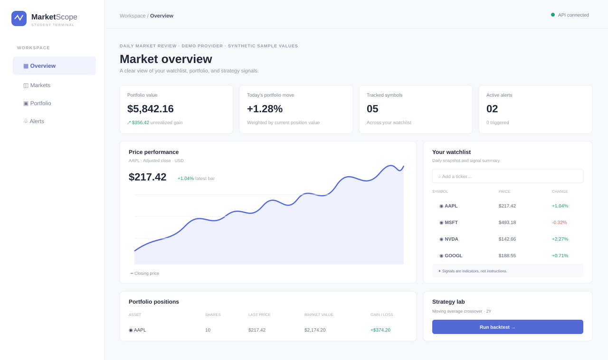
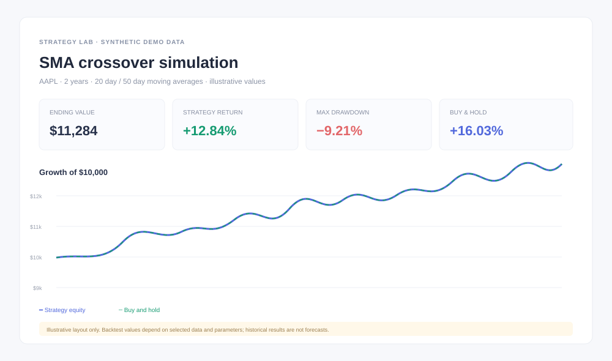
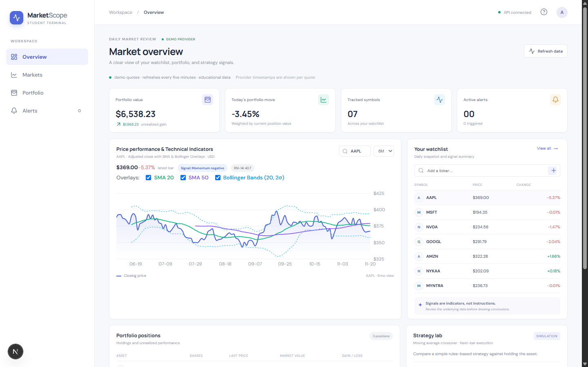

# Stock Market Data Analyzer

[](https://www.python.org/)
[](https://fastapi.tiangolo.com/)
[](https://nextjs.org/)
[](LICENSE)

An educational, full-stack financial data analytics system built for exploring historical market behavior, technical indicators, portfolio tracking, threshold alerts, and trading strategy backtests with zero paid subscriptions or API keys required.





> **IMPORTANT DISCLAIMER:** This project is strictly for educational and portfolio demonstration purposes. All price data, technical indicators, descriptive signals, and backtest results are mathematical models and do **NOT** constitute investment advice or trading recommendations.

---

## Table of Contents
1. [Project Overview](#project-overview)
2. [Problem Statement & Industry Relevance](#problem-statement--industry-relevance)
3. [Tech-Stack Options & Scope Selection](#tech-stack-options--scope-selection)
4. [Key Features](#key-features)
5. [Architecture & Workflow](#architecture--workflow)
6. [Repository Folder Structure](#repository-folder-structure)
7. [Installation & Setup Guide](#installation--setup-guide)
8. [Running the Application](#running-the-application)
    - [Option 1: Command-Line Interface (CLI)](#1-command-line-interface-cli)
    - [Option 2: Interactive Streamlit Dashboard](#2-interactive-streamlit-dashboard-option-b)
    - [Option 3: Full-Stack Web Application (FastAPI + Next.js)](#3-full-stack-web-application-fastapi--nextjs-option-c)
9. [Sample Verification Output](#sample-verification-output)
10. [Data Sources & Limitations](#data-sources--limitations)
11. [Backtesting Assumptions & Risk Caveats](#backtesting-assumptions--risk-caveats)
12. [Learning Outcomes by Role](#learning-outcomes-by-role)
13. [GitHub Upload & Proof-of-Work Guide](#github-upload--proof-of-work-guide)

---

## Project Overview

The **Stock Market Data Analyzer** provides an end-to-end financial data pipeline that ingests raw historical equities data, normalizes time-series records, computes standard technical indicators, evaluates quantitative momentum signals, executes a lookahead-bias-free backtesting simulation, and surfaces insights across three interfaces:
1. **Command-Line Interface (CLI)**: High-speed analysis producing cleaned CSVs, high-resolution Matplotlib/Seaborn charts, and Markdown reports.
2. **Interactive Streamlit Dashboard**: Python-centric interactive visual explorer.
3. **Full-Stack Web Application**: Threadpool-managed FastAPI REST backend paired with a reactive Next.js TypeScript dashboard.

---

## Problem Statement & Industry Relevance

### The Challenge
Students and aspiring quantitative developers often face steep barriers when studying financial software engineering:
- Commercial financial data terminals (Bloomberg, Refinitiv) cost thousands of dollars per month.
- Many public financial APIs require paid subscriptions, restrictive rate limits, or mandatory credit card registration.
- Beginners frequently introduce **lookahead bias** (using future data to predict the past) into backtests and confuse past performance with future predictive guarantees.

### The Solution
This project eliminates commercial terminal dependencies by supporting:
- **Deterministic Synthetic Demo Data**: A seeded Geometric Brownian Motion (GBM) generator enabling 100% offline development, testing, and continuous integration.
- **CSV Ingestion**: Direct loading of historical price records with flexible column mappings.
- **Public History Extraction**: Free adjusted price downloads via `yfinance` with automatic fallback to local datasets if the network is unavailable.
- **Lookahead-Bias-Free Execution**: Mandatory 1-bar execution delays (`shift(1)`) and transaction friction modeling.

---

## Tech-Stack Options & Scope Selection

This repository is designed to accommodate three educational learning paths:

| Scope | Difficulty | Technologies | Best For |
|---|---|---|---|
| **Option A — Easy** | Beginner | Python, `datetime`, pandas, NumPy, CSV, Matplotlib | Students learning foundational Python data cleaning, returns, and moving averages via scripts or notebooks. |
| **Option B — Intermediate** | Intermediate | Python, pandas, NumPy, `datetime`, yfinance / CSV, Matplotlib, Seaborn, Streamlit | **Recommended starting point** for students focusing on Python analytics and interactive dashboards. |
| **Option C — Advanced** *(Implemented)* | Advanced | Python, pandas, NumPy, FastAPI, Next.js, TypeScript, Custom CSS | Students building a comprehensive full-stack portfolio application with decoupled API and web UI. |

*Note: All three interfaces share the identical, reusable quantitative engine in `src/stock_analyzer/`.*

---

## Key Features

- **Multi-Source Data Ingestion**: Seamless switching between offline synthetic demo data, CSV files, and Yahoo Finance.
- **Robust Data Cleaning**: Automatic datetime parsing, timezone stripping, deduplication, chronological sorting, and bad-row filtering.
- **Technical Indicator Suite**:
  - Simple Moving Averages: Configurable fast and slow windows (default 20 & 50 sessions).
  - Exponential Moving Averages: EMA 12 and EMA 26.
  - MACD: 12/26-period spread with 9-period signal line and histogram.
  - Wilder's RSI (14-period): Exponentially smoothed relative strength oscillator.
  - Bollinger Bands: 20-period moving average with $\pm 2$ standard deviation envelopes.
- **Lookahead-Corrected Backtester**:
  - Moving average crossover simulation.
  - Compounded strategy equity vs. Buy & Hold benchmark.
  - Transaction friction deduction (configurable basis points).
  - Risk metrics: Total Return %, CAGR %, Maximum Drawdown %, Sharpe Ratio.
- **Triple Interface Delivery**:
  - CLI batch pipeline.
  - Lightweight Streamlit app.
  - Full-stack FastAPI REST API + Next.js interactive frontend.
- **Automated Reporting**: Formats professional Markdown reports and exports cleaned CSV datasets.

---

## Architecture & Workflow

```text
Inputs:
Ticker symbol + Date range + Provider source + Analysis parameters
                         │
                         ▼
Data Collection:
Yahoo Finance API  ──►  CSV Fallback  ──►  Deterministic Demo (GBM)
                         │
                         ▼
Data Cleaning & Normalization:
Parse dates → Lowercase headers → Sort chronologically → Deduplicate → Drop nulls
                         │
                         ▼
Quantitative Engine:
Daily/Period returns → Fast/Slow SMA → EMA 12/26 → MACD → Wilder's RSI → Bollinger Bands
                         │
                         ▼
Simulation Engine:
Moving average crossover signal → Shift 1 bar (No Lookahead) → Deduct friction → Compounded equity
                         │
                         ▼
Outputs & Interfaces:
├── CLI: Saves charts (*.png), cleaned CSV (*.csv), and Markdown summary (*.md)
├── Streamlit: Interactive Python dashboard
└── FastAPI + Next.js: REST API routes + Reactive web UI
```

---

## Repository Folder Structure

```text
Stock-Market-Data-Analyzer/
├── data/
│   ├── raw/                           # Raw inputs (DEMO.csv, AAPL.csv, sample.csv)
│   └── processed/                     # Cleaned, indicator-enriched CSV outputs
├── notebooks/
│   └── stock_analysis_walkthrough.ipynb # Step-by-step Jupyter educational guide
├── src/
│   └── stock_analyzer/                # Reusable core quantitative engine
│       ├── __init__.py                # Package exports
│       ├── data.py                    # Multi-source ingestion & cleaning
│       ├── analysis.py                # Financial mathematics, indicators & backtest
│       ├── charts.py                  # Matplotlib / Seaborn visualization
│       ├── report.py                  # Markdown summary report writer
│       └── pipeline.py                # End-to-end orchestration
├── backend/                           # Option C: FastAPI REST API
│   ├── app/                           # API routes, Pydantic schemas, data stores
│   ├── data/                          # JSON persistent storage & sample CSVs
│   ├── requirements.txt               # Backend dependencies
│   └── run.py                         # Backend launch script
├── frontend/                          # Option C: Next.js TypeScript Dashboard
│   ├── app/                           # App Router pages, CSS styles, layouts
│   ├── package.json                   # Frontend npm dependencies
│   └── tsconfig.json                  # TypeScript configuration
├── outputs/                           # Directory for CLI generated charts and CSVs
├── images/
│   └── screenshots/                   # Vector UI previews (*.svg) & live dashboard screenshot (*.png)
├── reports/                           # Generated Markdown analysis reports
├── docs/                              # Comprehensive documentation guides
│   ├── architecture.md                # System design & layer specifications
│   ├── implementation-plan.md         # 10-phase beginner implementation guide
│   ├── installation.md                # Environment setup for Windows and macOS
│   ├── tech-stack-options.md          # Comparison of Options A, B, and C
│   ├── six-day-plan.md                # Day-wise proof-of-work commit plan
│   └── interview-prep.md              # Technical interview Q&A guide
├── execution_docs/                    # Technical documentation & execution log
├── main.py                            # CLI entrypoint
├── streamlit_app.py                   # Optional Streamlit interactive dashboard
├── verify_project.py                  # Automated 5-stage validation script
├── requirements.txt                   # Unified Python dependencies
├── .gitignore                         # Git exclusion rules
├── LICENSE                            # MIT License
└── PROJECT_REVIEW_REPORT.md           # Technical handoff review report
```

---

## Installation & Setup Guide

### System Requirements
- **Python**: Version 3.11, 3.12, or 3.13.
- **Node.js** *(for Option C)*: Version 20.9+ with npm.

### 1. Virtual Environment Setup

#### Windows (PowerShell)
```powershell
# Clone the repository
git clone https://github.com/agarwalkratika26/stock-market-data-analyzer.git
cd "Stock Market Data Analyzer"

# Create virtual environment
python -m venv .venv

# Activate virtual environment
.\.venv\Scripts\Activate.ps1

# Install dependencies
python -m pip install --upgrade pip
pip install -r requirements.txt
```

#### macOS / Linux (Bash)
```bash
# Clone the repository
git clone https://github.com/agarwalkratika26/stock-market-data-analyzer.git
cd "Stock Market Data Analyzer"

# Create virtual environment
python3 -m venv .venv

# Activate virtual environment
source .venv/bin/activate

# Install dependencies
python3 -m pip install --upgrade pip
pip install -r requirements.txt
```

---

## Running the Application

### 1. Command-Line Interface (CLI)

Run an end-to-end analysis using offline synthetic demo data (no network needed):
```powershell
python main.py --ticker AAPL --source demo
```

Run an analysis using a local CSV (specifying date range matching the CSV dates):
```powershell
python main.py --ticker DEMO --source csv --csv-path data/raw/DEMO.csv --start 2025-01-01 --end 2025-02-15
```

Run an analysis using live Yahoo Finance data:
```powershell
python main.py --ticker MSFT --source yfinance --fast-window 20 --slow-window 50
```

All CLI outputs (charts, cleaned CSV, and markdown report) are saved to `outputs/<TICKER>/`.

---

### 2. Interactive Streamlit Dashboard (Option B)

Launch the interactive Python browser dashboard:
```powershell
streamlit run streamlit_app.py
```
Open [http://localhost:8501](http://localhost:8501) in your browser.

---

### 3. Full-Stack Web Application (FastAPI + Next.js) (Option C)

#### Step 1: Start the Backend API
In terminal 1:
```powershell
cd backend
python run.py
```
The FastAPI documentation will be available at [http://127.0.0.1:8000/docs](http://127.0.0.1:8000/docs).

#### Step 2: Start the Next.js Frontend Dashboard
In terminal 2:
```powershell
cd frontend
npm install
Copy-Item .env.example .env.local
npm run dev
```
Open [http://localhost:3000](http://localhost:3000) to view the interactive dashboard.

---

## Sample Verification Output

The project includes an automated test script that verifies data ingestion, indicator accuracy, backtest execution, and API endpoints:
```powershell
python verify_project.py
```

**Expected Terminal Output**:
```text
--> [1/5] Testing Data Ingestion (Demo and CSV)...
    Pass: Demo loaded (252 bars), CSV loaded (30 bars).
--> [2/5] Testing Technical Indicators & Financial Math...
    Pass: Indicators calculated correctly. Trend: 'SMA 20 (294.23) < SMA 50 (309.75)...'
--> [3/5] Testing Strategy Backtesting Simulation...
    Pass: Backtest executed. Ending value: $9,604.37, Trades: 4
--> [4/5] Testing FastAPI Application Routes...
    Pass: All FastAPI endpoints responded with HTTP 200 OK.
--> [5/5] Testing Generated Output Artifacts...
    Pass: All generated charts, CSVs, and markdown reports verified.

========================================================
ALL AUTOMATED VERIFICATION CHECKS PASSED SUCCESSFULLY!
========================================================
```

---

## Data Sources & Limitations

1. **Deterministic Synthetic Demo (`demo`)**:
   - Generates reproducible OHLCV bars using a Geometric Brownian Motion model seeded via `SHA256(ticker)`.
   - **Limitation**: Synthetic numbers for offline testing and education only. Never present this as real market prices.
2. **Yahoo Finance (`yfinance`)**:
   - Public market data scraper subject to provider throttling, rate limits, and exchange delays (typically 15 minutes).
   - **Limitation**: Not guaranteed real-time or exchange-direct; intended solely for learning.
3. **Local CSV (`csv`)**:
   - Ingests user-supplied price files matching `date,close` (and optional `open,high,low,volume`).
   - Lines beginning with `#` are treated as comments.

---

## Backtesting Assumptions & Risk Caveats

- **Next-Bar Execution**: Trading signals generated on day $t$ execute on session $t+1$ (`position.shift(1)`), eliminating lookahead bias.
- **Friction Modeling**: 10 basis points (0.10%) transaction cost is deducted per position turnover.
- **Allocation Rules**: Long or Cash (100% equity or 0% equity). No shorting, leverage, or borrowing fees.
- **Survivorship & Corporate Action Biases**: Historical simulation does not account for delisted companies, dividend cash flows, stock splits prior to adjusted feeds, or bid-ask liquidity limits.
- **Non-Predictive**: Past simulated performance is never indicative of future market returns.

---

## Learning Outcomes by Role

- **Python Developer**: Modular code architecture, standard library usage (`datetime`, `hashlib`, `pathlib`), dependency management, Pydantic validation.
- **Data Analyst**: Time-series normalization, handling edge cases, vectorized calculations in Pandas/NumPy, Matplotlib/Seaborn charting.
- **Financial Analyst**: Technical indicator mathematics (EMA, MACD, Wilder's RSI, Bollinger Bands), risk-adjusted metrics (CAGR, Max Drawdown, Sharpe Ratio).
- **Full-Stack Developer**: Synchronous FastAPI route handlers with worker threadpool execution, CORS middleware, Next.js App Router, SVG and Recharts data visualization.

---

## GitHub Upload & Proof-of-Work Guide

Follow the [GitHub and Portfolio Guide](docs/github-and-portfolio.md) and [Six-Day Implementation Plan](docs/six-day-plan.md) to showcase incremental commits, descriptive documentation, and project artifacts on your personal GitHub profile.
