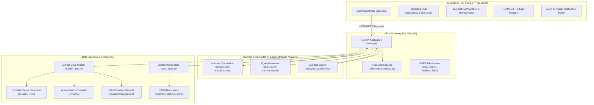

# 01 - Architecture and System Design

## 1. High-Level Architecture Overview

The **Stock Market Data Analyzer** is architected as a decoupled, multi-tier financial analytics application designed for modularity, low-latency computational processing, and offline resilience.

The system is structured into three primary operational tiers:
1. **Presentation Tier (Frontend)**: Next.js 14+ (React, Custom CSS, TypeScript, Recharts interactive charting) delivering real-time metric visualization, interactive portfolio tracking, alert notifications, and backtest scenario configuration.
2. **Application & Analytics Tier (Backend API & Computation)**: FastAPI web framework using synchronous `def` route handlers executed across threadpool workers paired with NumPy and Pandas. Handles vectorized time-series computation, technical indicator modeling, backtest simulation, and RESTful routing without blocking the ASGI event loop.
3. **Data & Persistence Tier**: Multi-source data adapter supporting deterministic synthetic simulation, external provider extraction (Yahoo Finance via `yfinance`), and local CSV ingestion, accompanied by atomic JSON document stores for watchlists, alerts, and user holdings.

---

## 2. Component Breakdown

### 2.1 Backend Architecture
- **FastAPI Core (`backend/app/main.py`)**: Synchronous `def` endpoint handlers executed via worker threadpools, providing structured endpoints (`/api/market/*`, `/api/watchlist`, `/api/portfolio`, `/api/alerts`, `/api/backtest`). Implements dependency-free startup and non-blocking I/O.
- **Pydantic Validation Layer (`backend/app/schemas.py`)**: Enforces strict boundary validation on incoming payloads (e.g. `fast_window` between 2 and 100, `slow_window` between 3 and 250, positive share counts, strictly typed alert conditions).
- **Analytics Engine (`backend/app/analytics.py`)**: Pure functional module operating on immutable Pandas DataFrames. Vectorized calculations ensure $O(N)$ execution speed even over thousands of historical bars.
- **Storage Subsystem (`backend/app/data_store.py`)**: Employs atomic write semantics (`tempfile.replace`) to prevent file corruption in single-node JSON persistence.

### 2.2 Frontend Architecture
- **App Router (`frontend/app/page.tsx`)**: Single-page reactive dashboard featuring optimistic UI updates, scheduled background polling (every 300 seconds), and manual ticker switching.
- **Pure SVG Charting**: Renders OHLC candlesticks, SMA overlays, EMA lines, Bollinger Band envelopes, and equity curves without third-party heavy charting bloat, maintaining maximum rendering efficiency and custom styling.

### 2.3 Standalone Analyzer (`python_analyzer/`)
- A decoupled CLI and Streamlit analytical subsystem designed for localized command-line reporting (`python main.py --symbol AAPL --period 1y`) and interactive exploration without spinning up the full multi-tier web application.

---

## 3. Design Principles & Patterns
- **Provider Abstraction**: Data source retrieval is decoupled through an adapter pattern in `market_data.history()`. Switching from synthetic to live market data requires changing a query parameter or environment variable without modifying downstream analytical code.
- **Pure Functional Transformations**: Analytical routines do not mutate input data frames; they accept an immutable `pd.DataFrame` and return transformed frames or serialized Python dicts.
- **Lookahead Bias Prevention**: Backtesting operations enforce an explicit 1-bar shift (`.shift(1)`) on trading signals, guaranteeing that trading decisions can only be executed at future open/close prices rather than the signal generation bar itself.
- **Atomic File Writing**: File writes create `.tmp` files first and perform an atomic OS-level replacement (`replace()`), guaranteeing transactional integrity even during unexpected server termination.
