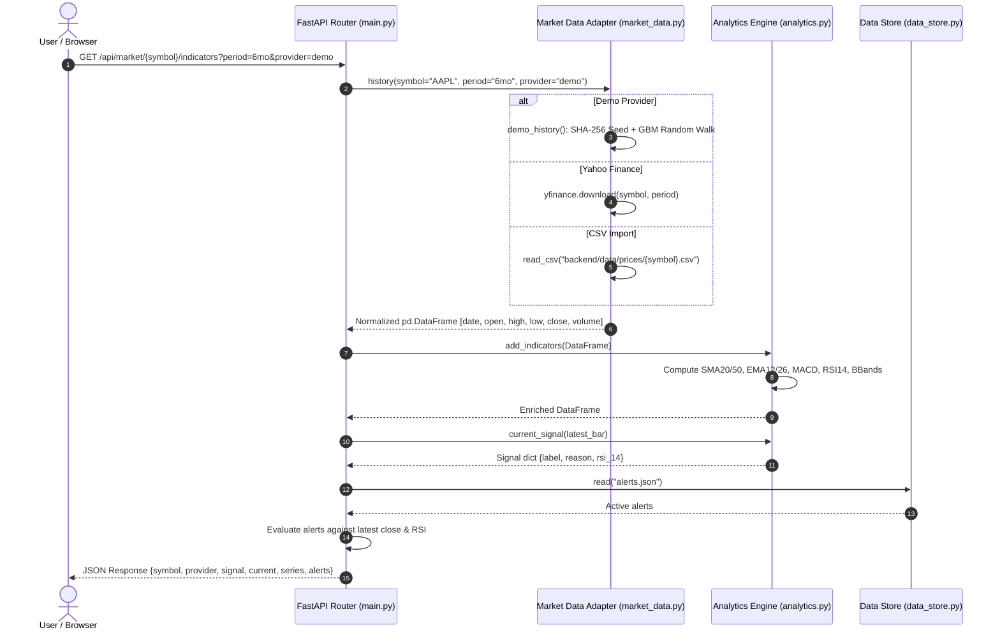
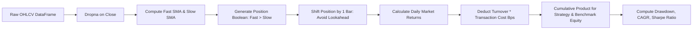

# 02 - Data Flow and Lifecycle

## 1. End-to-End Data Pipeline Architecture

Data flows through the system in five distinct, strictly ordered phases:
1. **Extraction / Ingestion**: Fetching raw time-series data from one of three providers (Synthetic Demo, Yahoo Finance API, or CSV).
2. **Standardization & Preprocessing**: Sanitizing headers, sorting chronologically by date, casting numeric types, and removing NaN records.
3. **Feature Engineering & Indicator Calculation**: Vectorized computation of SMAs, EMAs, MACD, Wilder's RSI, and Bollinger Bands using Pandas/NumPy.
4. **Signal Determination & Downstream Evaluation**: Extracting the latest bar metrics to evaluate overbought/oversold states and evaluating active user alerts.
5. **Serialization & Presentation**: Transforming DataFrames into JSON payloads for FastAPI REST endpoints and client-side SVG rendering.

---

## 2. Ingestion & Transformation Details

### Phase 1: Ingestion
- Input parameters: `symbol` (e.g. `"AAPL"`), `period` (`"1mo"`, `"3mo"`, `"6mo"`, `"1y"`, `"2y"`), and `provider` (`"demo"`, `"yfinance"`, `"csv"`).
- Target bar counts mapped via `VALID_PERIODS`:
  - `1mo`: 23 business days
  - `3mo`: 66 business days
  - `6mo`: 132 business days
  - `1y`: 252 business days
  - `2y`: 504 business days

### Phase 2: Sanitization & Normalization
- Regardless of source, the adapter guarantees:
  - Columns lowercased: `['date', 'open', 'high', 'low', 'close', 'volume']`.
  - Date converted to `pd.to_datetime` and sorted in ascending order.
  - Multi-index headers flattened (specifically addressing Yahoo Finance multi-level headers).
  - Nulls dropped via `.dropna()`.

### Phase 3: Analytical Transformation
- Transformed by `add_indicators(frame)`:
  - `sma_20`, `sma_50`: Rolling arithmetic means.
  - `ema_12`, `ema_26`: Exponentially weighted moving averages ($\alpha = \frac{2}{span + 1}$).
  - `macd`: Difference of `ema_12 - ema_26`.
  - `macd_signal`: 9-day EMA of `macd`.
  - `rsi_14`: Wilder's Exponential Smoothing with $\alpha = 1/14$ over positive/negative price changes.
  - `bb_upper`, `bb_lower`: 20-day rolling mean $\pm 2$ standard deviations.

### Phase 4: Backtest Data Flow

