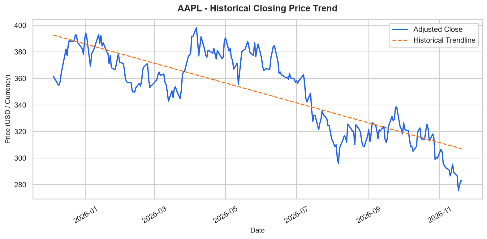
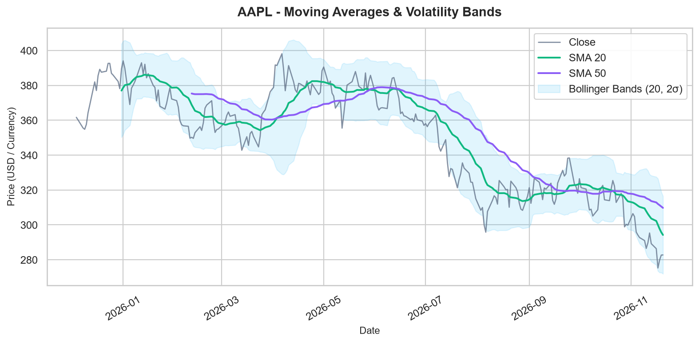
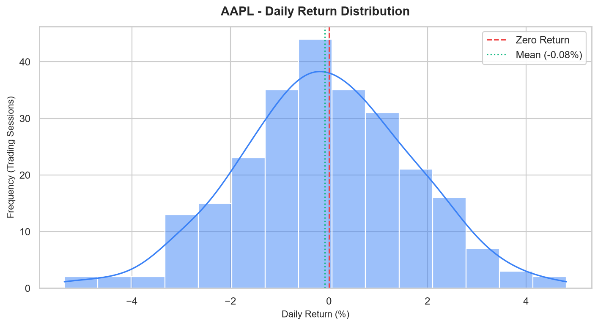
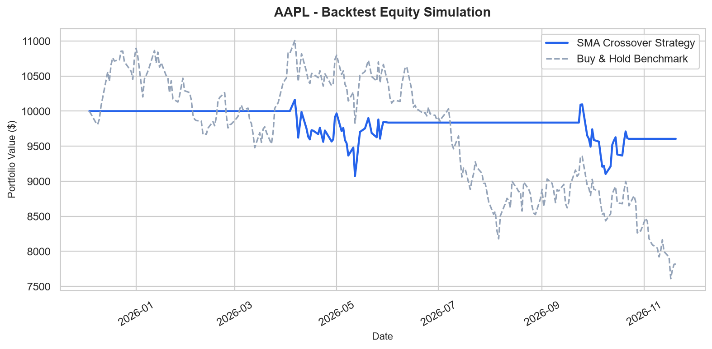

# Technical Stock Analysis Report: AAPL

> **Educational Notice:** This report is generated automatically for educational and analytical purposes. All calculations are mathematical models and do NOT constitute investment advice or trading recommendations.

---

## 1. Dataset & Collection Metadata

- **Ticker Symbol:** `AAPL`
- **Data Provider / Source:** demo (synthetic)
- **Date Range Analyzed:** 2025-12-04 to 2026-11-20
- **Trading Sessions Observed:** 252 bars
- **First Recorded Close:** $361.67
- **Latest Observed Close:** $282.75

---

## 2. Price Performance & Volatility Summary

- **Period Cumulative Return:** -21.82%
- **Annualized Return Volatility:** 27.78% (computed via $\sigma_{\text{daily}} \times \sqrt{252}$)
- **Highest Observed Price:** $400.78 on 2026-04-06 (from `high` field)
- **Lowest Observed Price:** $271.83 on 2026-11-17 (from `low` field)
- **Best Single-Session Return:** +4.82%
- **Worst Single-Session Return:** -5.37%
- **Up / Down Session Ratio:** 120 positive vs. 131 negative sessions

---

## 3. Technical Indicator Context & Signals

- **Fast Simple Moving Average (SMA 20):** $294.23
- **Slow Simple Moving Average (SMA 50):** $309.75
- **Trend Evaluation:** SMA 20 (294.23) < SMA 50 (309.75) (bearish/negative trend context)
- **Descriptive Indicator Signal:** **Momentum negative**
- **Signal Rationale:** MACD line is currently below its 9-day signal line. (RSI-14: 37.81)

*Note: Technical indicator signals are backward-looking descriptions of mathematical patterns and must not be interpreted as future price predictions.*

---

## 4. Moving Average Crossover Backtest Simulation

- **Strategy Parameters:** Fast SMA = 20 sessions, Slow SMA = 50 sessions
- **Transaction Friction:** 10.0 bps per trade turnover
- **Initial Capital:** $10,000.00
- **Ending Strategy Equity:** $9,604.37
- **Strategy Total Return:** -3.96%
- **Compound Annual Growth Rate (CAGR):** -3.96%
- **Maximum Drawdown:** -10.72%
- **Sharpe Ratio (Annualized):** -0.22
- **Benchmark Buy & Hold Return:** -21.82%
- **Total Trades Executed:** 4

### Simulation Assumptions & Friction Rules:
- Long or cash allocation; no margin, shorting, or leverage.
- Signals execute on the next bar's close/open (shifted by 1 bar to prevent lookahead bias).
- Transaction cost modeled at 10 basis points per turnover.
- Historical simulation excludes taxes, market impact, borrow fees, and dividend cash adjustments.
- Past backtested performance is educational and does NOT guarantee future market results.

---

## 5. Visualizations

---

## 6. Mathematical Methodology & Limitations

1. **Daily Returns:** Calculated via log/percentage difference between consecutive adjusted close bars: $R_t = \frac{C_t - C_{t-1}}{C_{t-1}}$.
2. **Annualized Volatility:** Sample standard deviation of daily returns scaled by the square root of 252 regular trading sessions: $\sigma_{\text{ann}} = \sigma_{\text{daily}} \times \sqrt{252}$.
3. **Lookahead Bias Prevention:** In backtesting, trading positions are shifted forward by one session ($t+1$) so that execution happens after the observation bar has completed.
4. **Data Provider Caveats:** Free public feeds (Yahoo Finance) or synthetic simulations may include delays, adjustments, or fictional data. Real execution environments incur slippage, bid-ask spread friction, market impact, and corporate tax consequences not fully modeled here.
